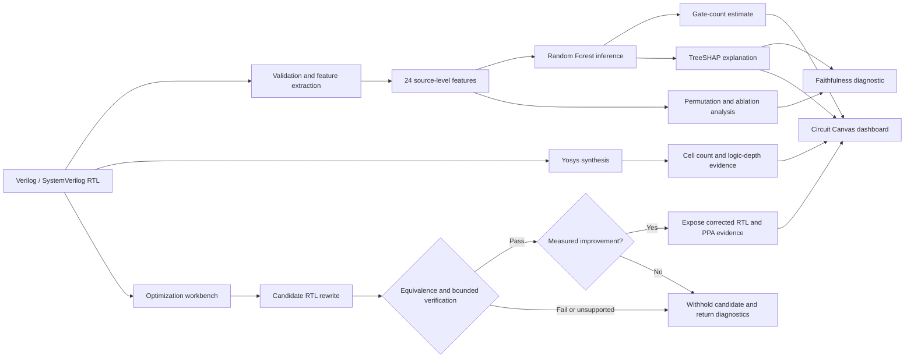
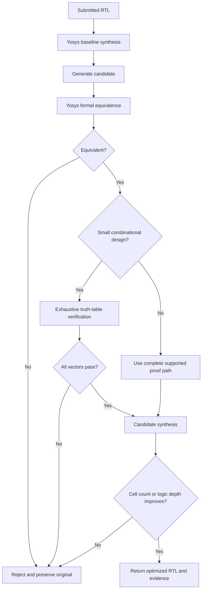

<div align="center">
  
  <h1>AICHD</h1>
  <p><strong>Explainable RTL gate-count estimation with synthesis evidence and verification-aware optimization.</strong></p>
  <p>
    <a href="https://github.com/mohamedzayn472/aichd-rtl-gate-dashboard"></a>
    <a href="https://nextjs.org/"></a>
    <a href="https://www.python.org/"></a>
    <a href="https://yosyshq.net/yosys/"></a>
  </p>
  <p>
    <a href="https://github.com/mohamedzayn472/aichd-rtl-gate-dashboard"></a>
    <a href="https://github.com/mohamedzayn472/aichd-rtl-gate-dashboard"></a>
  </p>
</div>

---

## What is AICHD?

AICHD is an end-to-end research and engineering platform for estimating the hardware cost of Verilog/SystemVerilog RTL before a full synthesis run. It combines a lightweight machine-learning estimator with Yosys-backed synthesis evidence, TreeSHAP explanations, ablation analysis, and a safety-gated optimization workbench.

The project is designed to answer three practical questions early in the RTL workflow:

1. **How large is this design likely to be?**
2. **Which source-level features drive the estimate?**
3. **Can a candidate rewrite be accepted without changing the design’s function?**

The active web application uses a light technical **Circuit Canvas** interface and exposes the workflow through an interactive Next.js dashboard.

## At a glance

| Capability | Current implementation |
|---|---|
| Source representation | 24 structural, operator, complexity, and bit-width features |
| Training benchmark | 500 generated RTL modules |
| Default inference model | Random Forest regressor |
| Explanation | TreeSHAP and permutation-based importance |
| Explanation diagnostic | Mean-replacement ablation with ranking comparisons |
| Synthesis evidence | Yosys cell counts and logic depth |
| Verification gates | Yosys equivalence checking plus exhaustive simulation for eligible small combinational designs |
| External stress test | 17 open-source RTL modules |
| Dashboard | Next.js 15, React 19, TypeScript, Tailwind CSS, Recharts, Framer Motion |

## System architecture



### Verification-aware optimization gate



## Research evidence

The repository contains reproducible artifacts for model comparison, label provenance, explanation analysis, latency measurement, and real-RTL evaluation.

- **500 generated modules** form the main training and evaluation benchmark.
- A separate model-comparison study evaluates linear regression, Random Forest, XGBoost, and LightGBM.
- The zero-shot open-source benchmark contains **17 modules** and reports `R² = -0.068` with an MAE of `8,218.69` gates, highlighting the current distribution-shift limitation.
- A controlled 100-module benchmark reports batch ML inference at **423.2× faster** than the measured Yosys synthesis path.
- Explanation rankings are compared against mean-replacement ablation as an empirical diagnostic. This is not presented as proof of causal faithfulness.

The detailed artifacts are available in [`rtl_gate_estimator/results/`](rtl_gate_estimator/results/) and are synchronized into the dashboard for browser-based inspection.

## Dashboard routes

| Route | Purpose |
|---|---|
| `/` | Project overview and system introduction |
| `/predict` | Live RTL inference and optimization workbench |
| `/dashboard` | SHAP, ablation, and KPI analysis |
| `/faithfulness` | Explanation-ranking validation |
| `/validation` | Real-RTL evaluation and synthesis evidence |
| `/model-comparison` | Regressor comparison |
| `/learning-curve` | Training-size analysis |
| `/latency` | ML versus synthesis timing |
| `/docs` | Developer and pipeline documentation |

## Quick start

### 1. Prerequisites

- Python 3.11 or newer
- Node.js 18 or newer
- Yosys for synthesis-backed metrics
- Icarus Verilog for bounded exhaustive simulation

Yosys is a system package, not a pip dependency. Install it using your platform’s package manager or the official release instructions.

### 2. Install Python dependencies

```bash
python -m venv .venv

# Windows
.venv\\Scripts\\activate

# Linux/macOS
source .venv/bin/activate

pip install -r requirements.txt
```

### 3. Run the research pipeline

```bash
cd rtl_gate_estimator
python run_pipeline.py
```

The pipeline performs RTL generation, feature extraction, label collection, model training, SHAP analysis, ablation, and faithfulness reporting.

### 4. Launch the dashboard

```bash
cd dashboard
npm install
npm run dev
```

Open [http://localhost:3000](http://localhost:3000).

### 5. Run a direct prediction

```bash
cd rtl_gate_estimator
python scripts/predict.py --input path/to/design.v --json
```

## Repository layout

```text
.
├── dashboard/                 # Canonical Next.js application
│   ├── app/                   # Routes, API bridge, and Circuit Canvas UI
│   ├── components/            # Shared dashboard components
│   ├── data/                  # Synchronized research artifacts
│   └── scripts/               # Data synchronization helpers
├── rtl_gate_estimator/        # Python research and inference backend
│   ├── scripts/               # Feature extraction, training, proof, and optimization
│   ├── data/                  # Generated and open-source RTL datasets
│   ├── models/                # Trained model artifacts
│   └── results/               # Metrics, reports, plots, and JSON evidence
├── paper/                     # Conference-paper sources and figures
├── tests/                     # Repository-level test configuration
├── Dockerfile                 # Render-compatible deployment image
├── render.yaml                # Render service configuration
└── README.md
```

## Safety and limitations

AICHD separates model evidence from synthesis and proof evidence. An ML estimate remains available when synthesis fails, but corrected RTL is not exposed unless the candidate passes the applicable verification gates and demonstrates a measured improvement. Sequential or unsupported designs may be withheld with diagnostics.

The current model is not a replacement for signoff synthesis. Its open-source stress-test result demonstrates that source-level features learned from generated RTL do not automatically generalize to large, hierarchical, parameterized, or memory-dominated designs.

## Documentation and artifacts

- [Project context](PROJECT_CONTEXT.md)
- [Abstract verification report](paper/ABSTRACT_VERIFICATION.md)
- [Paper source](paper/main.tex)
- [Optimizer correction log](rtl_gate_estimator/CORRECTION_LOG.md)
- [System architecture notes](dashboard/public/data/system_architecture.md)
- [Faithfulness report](rtl_gate_estimator/results/faithfulness_report.json)
- [Real-RTL evaluation](rtl_gate_estimator/results/real_rtl_evaluation.json)

## Authors

<div align="center">
  <p><strong>F Mohamed Zayn Ismail</strong></p>
  <p><strong>Jayaraj M</strong></p>
</div>

## Citation

```text
F Mohamed Zayn Ismail and Jayaraj M,
“AICHD: Explainable and Verification-Aware RTL Gate-Count Estimation,”
Research project, 2026.
```

## License

Academic research project. See the repository contents and institutional requirements before redistribution.

<p align="center"><sub>Built for auditable RTL design-space exploration.</sub></p>
