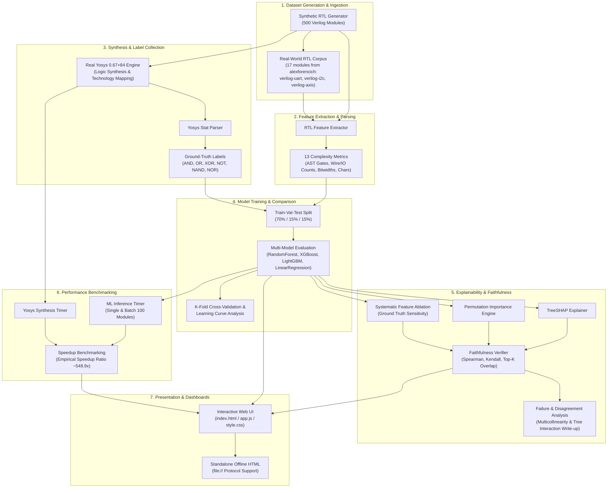

# End-to-End System Architecture

This document presents the complete architectural design of the **RTL Gate Count Estimator**, detailing the flow of data from Verilog code parsing to real Yosys synthesis ground-truth generation, machine learning model training, dual-method explainability (SHAP & Permutation), quantitative faithfulness verification, latency benchmarking, and interactive visual dashboards.

---

## High-Level Architecture Diagram

---

## Detailed Pipeline Component Description

### 1. Dataset Generation & Real RTL Ingestion
- **Synthetic Generator**: Parametric Verilog generator creating 500 distinct RTL modules with diverse logic densities, bitwidths, control flow constructs, and operator balances.
- **Real RTL Benchmark**: Curated set of 17 production-grade open-source Verilog modules sourced from the `alexforencich` GitHub repositories for out-of-distribution validation:
  - **verilog-uart** (commit `a69d2d0`): `uart.v`, `uart_tx.v`, `uart_rx.v`
  - **verilog-i2c** (commit `5b2bf23`): `i2c_master.v`, `i2c_master_axil.v`
  - **verilog-axis** (commit `880753a`): `axis_fifo.v`, `axis_pipeline_register.v`, `axis_register.v`, `axis_adapter.v`, `axis_crosspoint.v`, `axis_mux.v`, `axis_demux.v`, `axis_rate_limit.v`, `axis_broadcast.v`, `axis_arb_mux.v`, `arbiter.v`, `priority_encoder.v`
  - (3 additional modules — `axis_gmii_rx`, `axis_gmii_tx`, `lfsr` — were skipped due to synthesis issues and are excluded from evaluation metrics.)
  - Source: `data/real_rtl/SOURCES.md`, `data/real_rtl/labels_real.csv`.

### 2. Feature Extraction
Extracts 13 structured AST and syntactic complexity features:
- `complex_and_gates`, `complex_or_gates`, `complex_xor_gates`, `complex_not_gates`, `complex_nand_gates`, `complex_nor_gates`
- `struct_num_inputs`, `struct_num_outputs`, `struct_num_wires`
- `bitwidth_avg`, `bitwidth_max`
- `complex_lines`, `complex_chars`

### 3. Synthesis Ground-Truth Engine
- Calls real binary `Yosys 0.67+84 (git sha1 e2c27aaaf)` via `yosys_synthesis.py`.
  - Source: Yosys version banner read from `data/real_rtl/yosys_raw_logs/arbiter.log`.
- Executes synth commands (`proc; opt; fsm; opt; techmap; opt; stat`) to map Verilog directly to primitive technology gates.
- Parses Yosys JSON/stat outputs into ground-truth label vectors.

### 4. Machine Learning & Multi-Model Engine
- Trains four regression models: `RandomForest`, `XGBoost`, `LightGBM`, and `LinearRegression`.
  - Source: `results/model_comparison.json` (exactly four entries; no GradientBoosting or DecisionTree model was trained).
- Performs 5-Fold Stratified Cross-Validation and learning curve generation across dataset sizes $N \in [50, 500]$.
- Best in-distribution test metrics (from `results/model_comparison.json`):
  - RandomForest: test R² = 0.9612, test MAE = 3.63 gates
  - XGBoost: test R² = 0.9379, test MAE = 4.55 gates
  - LightGBM: test R² = 0.9718, test MAE = 3.44 gates
  - LinearRegression: test R² = 0.9963, test MAE = 1.36 gates

### 5. Dual-Method Explainability & Faithfulness Verifier
- **TreeSHAP**: Game-theoretic local feature attributions. Faithfulness Score = **0.9768**, Spearman ρ = **0.989** (source: `results/faithfulness_report.json`).
- **Permutation Importance**: Global feature shuffle sensitivity using $N=10$ random passes. Faithfulness Score = **0.9277**, Spearman ρ = **0.940** (source: `results/faithfulness_report_permutation.json`).
- **Feature Ablation**: Replaces each feature with its mean value to establish empirical prediction sensitivity ground truth.
- **Faithfulness Verifier**: Computes rank correlations (Spearman $\rho$, Kendall $\tau$) and top-$k$ overlap ratios against ablation scores.

### 6. Latency Benchmark Engine
- Measures microsecond-level wall-clock prediction timing for single modules and 100-module batches.
- Compares against real Yosys execution times on the exact same 100 modules to produce verified speedup ratios.
- Verified speedup: **548.9×** (ML: 0.3633 ms/module; Yosys: 199.43 ms/module). Source: `results/latency_benchmark.json`.

### 7. Interactive & Offline Dashboard
- Single-page application rendering real-time predictions, SHAP beeswarm/summary plots, model comparison tables, real RTL validation reports, learning curves, and latency speedup badges.
- Includes pre-baked `OFFLINE_DATA` for zero-dependency execution via `file://`.
